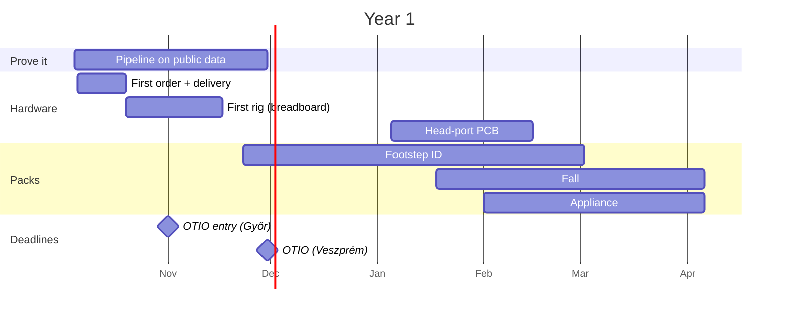

# Roadmap

Year 1 only. Milestones live in this note's properties; the dashboard reads them from there. Dates after November are targets, not commitments.

We work on **Monday and Tuesday** only, so every date falls on one of those days and durations count two work days a week. Delivery times are calendar time. Holidays are not yet planned in. Recounted 2026-10-05; the phone kill test was dropped the same day.

**2026-11-15: fall moves first** ([[D-023 Year 1 order fall first]], proposed). The HARMAN Hackathon detector already works, so the fall pack's job is now the port to the node ([[Port the fall core to ESP-IDF]]). The new pack dates are Claude's proposal and need Kaszti's or Viktor's OK. Footstep ID starts on the first walk-pass dataset and ends a month later than before.

**2026-11-23: footstep-id moves first again** ([[D-026 Year 1 order footstep-id first]], proposed). Kaszti set the first goal: recognise 1 of 3 people with ≥ 85 % accuracy. The pack dates go back to the pre-hackathon plan (footstep ID gate 2027-03-02, fall gate 2027-04-06 with appliance); they are Claude's proposal and need Kaszti's or Viktor's OK. The hackathon fall detector keeps working meanwhile; its port to the node waits.

**2026-11-23: footstep-id also tells the side of a step** ([[D-027 Footstep-id tells the side of a step]], proposed): left or right of the device, from the two geophones in the case (about 123 mm apart). Worked on together with person ID; its target is not set yet.

## Later (not Year 1 unless someone proposes it)
- From the hackathon device: phone call for help over a SIM868 modem, a voice prompt on a speaker, an "I'm OK" button, and a BLE link to the pages ([[D-024 Hackathon core is the fall pack engine]]).
