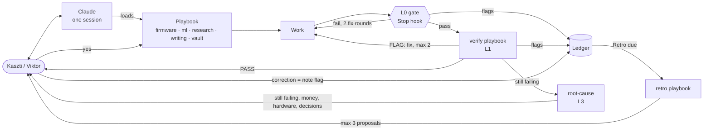

# Agent system

How Claude works in this repo: **one agent, many playbooks, and a retro that improves them**. Why: [[D-025 One agent with playbooks]] (proposed; supersedes [[D-013 Agent system]]). What changed when: [[Changelog]].

```dataviewjs
await dv.view("90 Meta/Views/rz", {section: "agents"})
```

## In one minute
- You talk to **one** Claude: the normal `claude` session started in the repo folder. It does the work itself. It doesn't hand anything to subagents.
- For each kind of work it loads a **playbook** first, a short checklist in `.claude/skills/<name>/SKILL.md`. Playbooks load only when needed, so they cost nothing the rest of the time.
- **Deterministic hooks** check everything it changed before it ends a reply (the **gate**). Code and decision-grade research also go through the **verify** playbook. Problems go into the **ledger**.
- The **retro** turns the ledger into at most three improvements. It is triggered by evidence, not by the calendar. You approve every change.



## The playbooks
| Playbook | When |
| --- | --- |
| `firmware` (+ `esp-idf-build-flash`) | any change under `firmware/`, on-device pack code, porting the hackathon fall core |
| `ml-training` | `ml/`, `tools/`, data manifests, test vectors, training and results |
| `research` | answers that need sources: parts, prices, datasheets, papers, datasets |
| `writing` | READMEs, docs, OTIO texts, study lessons |
| `vault-conventions` | any vault note: exact properties and editing rules |
| `verify` | after code, schema, pack or decision-grade research (L1) |
| `root-cause` | failed twice, or a hard cause across firmware, ml and hardware (L3) |
| `retro` | improving the system |
| `wrap-up` | end of a session |
| `find-skills` | "is there a skill for …" |

## Escalation ladder
| Level | What | When | What happens |
| --- | --- | --- | --- |
| L0 | Stop hook (`stop_gate.py`) | before Claude ends a reply | checks for the files edited since they last passed (vault rules, validate.py, ruff, pytest, `idf.py build`); two fix rounds, then a `gate-fail` flag |
| L1 | `verify` playbook | after code, schema, pack or decision-grade research | a cold re-read of the diff and a PASS / FLAG / BLOCK verdict; findings logged as `review` flags |
| L2 | retry | FLAG | fix with the findings, at most two rounds |
| L3 | `root-cause` playbook | still failing | reproduce, prove the cause, smallest fix; suggest a stronger model or effort |
| L4 | you | still failing, BLOCK, money, hardware, decisions | written in today's daily note and the Handoff; Claude asks |

## The retro
**Evidence:** the ledger (`90 Meta/Agents/Ledger/flags.jsonl`): gate failures, review findings, retries, escalations, and every time a person corrects Claude (`note` flags, logged right away).

**Trigger:** `python .claude/scripts/ledger.py retro-due` says *due* when, since the last retro, there is:
- a person's correction,
- a high-severity flag,
- three new flags,
- or flags at least a week old that no retro has reviewed.

The session start shows **Retro due** and Claude runs the retro at the next natural break. You can also type `/retro` at any time.

**Output:** a retro note in `Retros/` and at most three proposals in `Proposals/`. Each has the evidence, the exact diff, a way to check it (a test in `.claude/tests/`, a check run, or a replay of the flagged case), the risk and the rollback. The cheapest fix comes first, in this order:
1. a deterministic check,
2. one sentence in a playbook,
3. a new playbook section,
4. a `CLAUDE.md` rule,
5. a new playbook.

The retro also retires rules that never fire.

**Approval:** you say yes or no to each proposal. Only approved ones are applied (editing `.claude/` and `CLAUDE.md` asks permission anyway). Each one gets a line in the [[Changelog]]. Then `ledger.py retro-done` resets the trigger.

## What you type
| You want | Type |
| --- | --- |
| Start working | `claude` in `C:\Work\Projects\Enterpartner\Rezonating` |
| Use a playbook directly | `/verify`, `/research …`, or just describe the task |
| End a session properly | `/wrap-up` |
| Improvement round now | `/retro` |
| Is a retro due? | `python .claude/scripts/ledger.py retro-due` |
| See open flags | `python .claude/scripts/ledger.py list --open` |
| Run the gate by hand | `python .claude/scripts/checks.py` |
| Test the hooks themselves | `python -m unittest discover -s .claude/tests` |

## Rules the hooks enforce (not just ask for)
| Rule | Where |
| --- | --- |
| Checks pass before a reply ends (two fix rounds, then a flag) | `stop_gate.py` + `checks.py` |
| No Templater code in notes; Claude never accepts a decision or changes an accepted one | `pre_edit.py` |
| Nothing written to `data/raw/`, `data/private/`, `*.wav` | `pre_edit.py` + settings deny rules |
| Notes keep the property rules | `post_edit.py`, `stop_gate.py` |
| Code formatted (ruff, clang-format) | `post_edit.py` |
| No raw recordings in commits; vault and code never in one commit | `commit_guard.py` (+ `.githooks/pre-commit` for people) |
| Edits to `.claude/`, any `CLAUDE.md`, `schemas/`, `.mcp.json` ask a person first | settings `ask` rules |
| Force-push, `reset --hard`, `git clean`, `rm -rf`, global skill installs | settings `deny` rules |

## Files
```
CLAUDE.md                     project rules + the playbook table
firmware/CLAUDE.md, ml/CLAUDE.md
.claude/
  skills/*/SKILL.md           the playbooks
  rules/*.md                  path-scoped rules: vault notes, schemas
  hooks/*.py                  session_start, pre_edit, post_edit, commit_guard, stop_gate
  scripts/                    rzlib, vault_schema, checks (the gate), ledger (+ retro-due)
  tests/                      unittest suite for all of the above
  settings.json               permissions, hooks, plugins
.mcp.json                     espressif-docs (sign in once), esp-idf (needs ESP-IDF v6)
tools/local/                  local-model helpers (home desktop only)
90 Meta/Agents/
  Ledger/flags.jsonl, runs.jsonl, Changelog.md
  Proposals/, Retros/, Evals/Eval log.md (agent era, historical)
```

## Local models
Ollama runs only on Kaszti's home desktop. Claude Code always uses the Claude subscription. The local model only drafts cheap things through `tools/local/` (week summary, inbox triage), and its output is labelled as a draft. See `tools/local/README.md`.

## Adding a playbook
Only through the retro, or when you ask for one:
1. Create `.claude/skills/<name>/SKILL.md` with a `description` that says when to load it.
2. Add a row to the playbook table in `CLAUDE.md` and here.
3. Add a line to the [[Changelog]].
