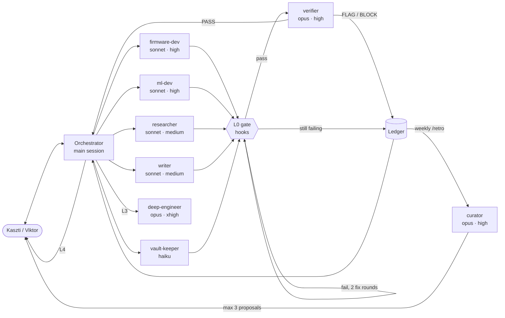

# Agent system

How Claude works as a team of agents in this repo. Why: [[D-013 Agent system]]. What changed when: [[Changelog]].

```dataviewjs
await dv.view("90 Meta/Views/rz", {section: "agents"})
```

## In one minute
- You talk to **one** Claude: the orchestrator, i.e. the normal `claude` session started in the repo folder (CMD or PowerShell). It plans, hands work to specialist agents, has the work checked and escalates when something fails.
- Each specialist runs on a set model and effort level, may write only in its own folders, and is checked by deterministic hooks the moment it finishes (the **gate**).
- A separate **verifier** on a different model reviews code and research before anything counts as done. Problems go into the **ledger**.
- Once a week (`/retro`, Tuesday) the **curator** reads the ledger and proposes at most three improvements, each with evidence and an eval. You approve each one; the system never rewrites itself.



## The agents
| Agent | Model · effort | Writes to | Used for |
| --- | --- | --- | --- |
| orchestrator | the session's model (Opus recommended) | everything, asks first for config | talking to you, planning, routing, small edits |
| `firmware-dev` | sonnet · high | `firmware/`, `packs/`, `docs/`, `tools/` | ESP-IDF C code, builds |
| `ml-dev` | sonnet · high | `ml/`, `tools/`, `data/` manifests, `packs/`, `docs/` | signal processing, training, test vectors |
| `researcher` | sonnet · medium | `60 Research/`, `00 Inbox/` | datasheets, prices, papers, datasets |
| `writer` | sonnet · medium | `docs/`, READMEs, `10 Project/`, `00 Inbox/` | docs, OTIO texts |
| `vault-keeper` | haiku | the numbered vault folders | work items, parts, daily lines, Handoff |
| `verifier` | opus · high | nothing (read-only) | independent review, verdict PASS / FLAG / BLOCK |
| `deep-engineer` | opus · xhigh | code folders + `schemas/` | escalations: failed twice, hard root causes |
| `curator` | opus · high | `90 Meta/Agents/` proposals, retros, evals | improving the agents |

Each agent's own instructions are its file in `.claude/agents/` (its personal CLAUDE.md). All of them also read the project `CLAUDE.md`; `firmware/CLAUDE.md` and `ml/CLAUDE.md` load when they work in those folders.

## Escalation ladder
| Level | Who | When | What happens |
| --- | --- | --- | --- |
| L0 | hooks | a specialist finishes | checks for the files it edited (vault rules, validate.py, ruff, pytest, `idf.py build`); on failure it is sent back, twice at most, then a `gate-fail` flag |
| L1 | verifier | after code, schema, pack or decision-grade research | PASS, or findings logged as `verifier-flag` |
| L2 | same agent | FLAG | retried with the findings, at most twice |
| L3 | deep-engineer, or a stronger model | still failing | full history handed over; root cause first |
| L4 | you | still failing, BLOCK, money, hardware, decisions | written in today's daily note and the Handoff, Claude asks |

## What you type
| You want | Type |
| --- | --- |
| Start working | `claude` in `C:\Work\Projects\Enterpartner\Rezonating` |
| Give work to one agent directly | mention it: `@agent-researcher find EU stock for …`, or just describe the task |
| End a session properly | `/wrap-up` |
| Weekly improvement round | `/retro` (Tuesday, after the work) |
| Look for an existing skill | "is there a skill for …" (the `find-skills` skill) |
| Check an agent's prompt quality | `/doctor prompt-audit .claude/agents/<name>.md` |
| Run the agent tests | `python .claude/scripts/run_evals.py --agent vault-keeper` |
| See open flags | `python .claude/scripts/ledger.py list --open` |
| Run the gate by hand | `python .claude/scripts/checks.py` |

## Rules the hooks enforce (not just ask for)
| Rule | Where |
| --- | --- |
| Agents write only in their folders | `pre_edit.py` + `.claude/agent-scopes.json` |
| No Templater code in notes; Claude never accepts a decision or changes an accepted one | `pre_edit.py` |
| Nothing written to `data/raw/`, `data/private/`, `*.wav` | `pre_edit.py` + settings deny rules |
| Notes keep the property rules | `post_edit.py`, gates, `stop_gate.py` |
| Code formatted (ruff, clang-format) | `post_edit.py` |
| No raw recordings in commits; Claude never mixes vault and code in one commit | `commit_guard.py` (+ `.githooks/pre-commit` for people) |
| Edits to `.claude/`, any `CLAUDE.md`, `schemas/`, `.mcp.json` ask a person first | settings `ask` rules |
| Force-push, `reset --hard`, `git clean`, `rm -rf`, global skill installs | settings `deny` rules |

## Files
```
CLAUDE.md                     project rules + orchestration policy (main session)
firmware/CLAUDE.md, ml/CLAUDE.md
.claude/
  agents/*.md                 one file per agent: model, effort, tools, instructions
  skills/*/SKILL.md           esp-idf-build-flash, ml-training, vault-conventions, wrap-up, retro, find-skills
  rules/*.md                  path-scoped rules: vault notes, schemas
  hooks/*.py                  session_start, pre_edit, post_edit, commit_guard, subagent_gate, agent_report, stop_gate
  scripts/                    rzlib, vault_schema, checks (the gate), ledger, run_evals
  evals/cases/<agent>/*.json  agent tests
  agent-scopes.json           where each agent may write
  settings.json               permissions, hooks, plugins
.mcp.json                     espressif-docs (sign in once), esp-idf (needs ESP-IDF v6)
tools/local/                  local-model helpers (home desktop only)
90 Meta/Agents/
  Ledger/flags.jsonl, runs.jsonl, Changelog.md
  Proposals/, Retros/, Evals/Eval log.md
```

## Local models
Ollama runs only on Kaszti's home desktop. Claude Code always uses the Claude subscription; the local model only drafts cheap things through `tools/local/` (week summary, inbox triage), and its output is labelled as a draft. See `tools/local/README.md`.

## Changing the agent system
1. **Evidence first:** a flag in the ledger, or a person's correction logged as a `note` flag.
2. **Proposal:** the curator (or you) writes `90 Meta/Agents/Proposals/P-### …` with the exact diff, the eval case and the rollback.
3. **Test:** `run_evals.py --agent <a>` before and with `--candidate "<proposal>"`.
4. **Review:** `/doctor prompt-audit <file>`, then a person says yes.
5. **Apply and record:** apply the diff, `status: applied`, one line in [[Changelog]], resolve the flags.

Adding an agent: its file in `.claude/agents/`, its scope in `agent-scopes.json`, its name in the `SubagentStop` matcher (`settings.json`) and in `SPECIALISTS` (`subagent_gate.py`), a routing row in `CLAUDE.md`, and at least one eval case.

## Known limits
- The gate checks files an agent changed with Edit/Write. A file written by a script the agent ran isn't seen; the verifier's `git diff` catches it.
- Effort can't be raised per task, only per agent; that's why `deep-engineer` exists.
- Model aliases (`sonnet`, `opus`, `haiku`) follow the newest model of that family. If a plan doesn't include one, Claude Code falls back to the session's model and shows a warning.
- Evals use subscription quota: run them for proposals, not every day.
- `.claude/` points at vault paths (the ledger). Before the repo goes open source, move the ledger out of the vault or drop it (see [[D-012 Obsidian vault in the repo]]).
